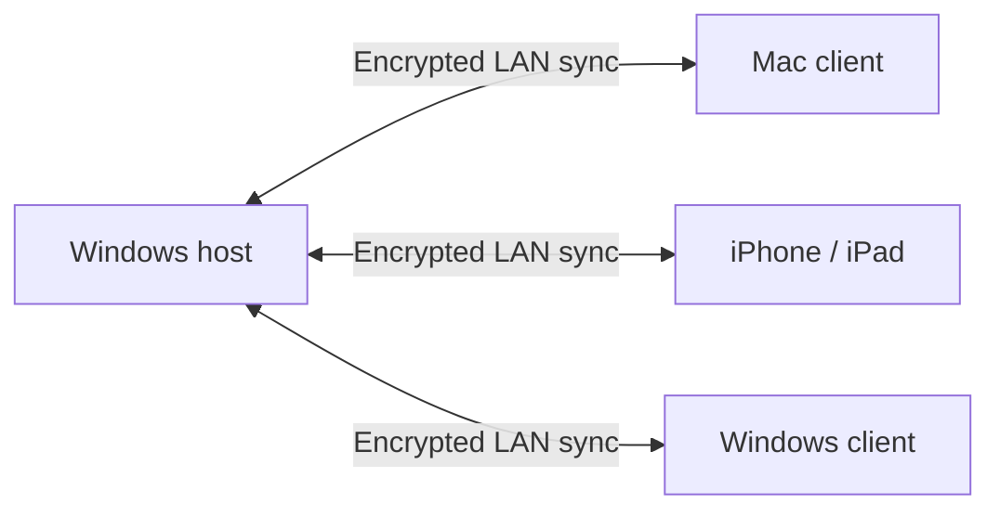

# Private QR Sync

**Private, encrypted, selective Obsidian sync over your local network — no cloud server, account, or subscription.**

[简体中文](README.zh-CN.md) · English

[](https://github.com/Xr-7777/private-qr-sync/releases/latest)
[](LICENSE)


Private QR Sync connects Obsidian vaults directly across **Windows, macOS, iPhone, and iPad** on the same trusted LAN. Pair a device with a short-lived QR code, choose exactly which notes or folders may move, and keep every device under an independent sync policy.

Your notes do not pass through the author's server. Requests and file bodies are encrypted between paired devices with **AES-256-GCM**. GitHub hosts the public source code and release assets; it never receives your vault data.

> **Available in the official directory:** install from Obsidian's Community Plugins browser. Start with a backup or test vault while the plugin remains in public beta.

## Why Private QR Sync?

- **No third-party sync server** — one of your own computers is the LAN host.
- **Selective by design** — sync one note, several folders, or the whole vault.
- **Transfer and sync are separate** — make a safe one-time copy without creating an ongoing relationship.
- **Per-device control** — independently pause each device and choose host ↔ device, host → device, or device → host.
- **Conflict recovery** — overwritten or deleted content is backed up before the target changes.
- **Mobile pairing that is actually usable** — scan the QR code with the iPhone or iPad system Camera.
- **Privacy-focused defaults** — deletion propagation is off, `.obsidian` is excluded, and secrets use Obsidian SecretStorage.
- **Bilingual interface** — switch between 中文 and English.

## At a glance

| Capability | Behavior |
| --- | --- |
| Network model | Direct device-to-host connection on a trusted private LAN |
| Platforms | Windows or macOS host; Windows, macOS, iPhone, or iPad client |
| Encryption | AES-256-GCM for requests and file bodies after pairing |
| Pairing | Ten-minute, single-use QR code or pairing link |
| Sync scope | Exact notes, selected folders, or the whole vault |
| Direction | Two-way, host → device, or device → host |
| One-time transfer | Never deletes; same-name different content becomes a second file |
| Deletions | Off by default; optional, directional, and backed up before removal |
| Cloud/account | Not required |
| Price/license | Free and open source under the MIT License |

## How it works



One computer stays open as the host. Every paired client receives its own revocable key and policy. A client compares SHA-256 manifests and transfers only changed files. The host does not upload your vault to GitHub or any third-party relay.

## Quick start

1. Create or open an Obsidian vault with the **same vault name** on every device.
2. Open Obsidian → Settings → Community plugins → Browse, search for **Private QR Sync**, then choose **Install** and **Enable**.
3. Repeat the installation on every device that will participate.
4. On the computer that will act as host, open Private QR Sync settings and choose **Show QR code**.
5. On iPhone/iPad, scan with the system Camera and open the link in Obsidian. On another computer, copy the pairing link and paste it under **Use this computer as a client**.
6. Back on the host, configure that device's direction, selected paths, deletion policy, and transfer permission.

Allow Obsidian through the firewall only on **Private networks**. Keep the host awake and Obsidian open while syncing.

## One-time transfer vs ongoing sync

### One-time transfer

Use this when you want to copy a few notes without linking their future edits.

- Enter exact note paths or folders ending in `/` on the client.
- Choose **Host → this device** or **This device → host**.
- Existing target-only notes are untouched.
- A same-name file with different content is saved as a visible second file.
- Nothing is deleted.

### Ongoing sync

Use this when selected notes should continue following changes.

- Configure each device independently on the host.
- Empty selected paths mean the whole vault.
- One-way sync treats the selected source as authoritative only for matching selected paths.
- Target-only and unselected notes remain untouched.
- Before a changed target is overwritten, its previous content is copied to `.private-qr-sync-conflicts/`.

Keep **Synchronize deletions** off unless deletion propagation is intentional. When enabled, only future deletions inside the selected paths follow the configured direction, with a recovery backup created first.

## Privacy and security boundary

- No note, attachment, account identifier, or telemetry is sent to a service operated by the author.
- Each paired device has a separate key stored through Obsidian SecretStorage.
- Encrypted responses are bound to the request nonce and endpoint to reject replayed or swapped responses.
- LAN observers can still see IP addresses, timing, message sizes, and endpoint paths.
- The LAN endpoint uses HTTP with encrypted application payloads; **do not expose its port to the public internet**.
- A live pairing QR code is a temporary credential. Do not photograph or share it.
- Revoking a device invalidates its stored key on the host.

## Current limitations

- All devices must be on the same reachable private network; there is no internet relay.
- The host computer must be awake with Obsidian open.
- iOS suspends community plugins in the background, so keep Obsidian open during transfer or sync.
- Obsidian settings and plugins under `.obsidian` are intentionally excluded. Install this plugin separately on each device.
- Files over 20 MB are skipped by default; the limit is configurable.
- Android has not been validated and is not currently advertised as supported.

## Release and development

- [Download the latest release](https://github.com/Xr-7777/private-qr-sync/releases/latest)
- [Report a bug or request a feature](https://github.com/Xr-7777/private-qr-sync/issues)

```bash
npm install
npm run check
```

For manual desktop installation, copy `main.js`, `manifest.json`, and `styles.css` into:

```text
<vault>/.obsidian/plugins/private-qr-sync/
```

## Prior art reviewed

- [LAN Vault Sync](https://github.com/senjanson/lan-vault-sync), MIT: desktop-host/mobile-client topology and Obsidian protocol QR pairing.
- [Vault Bridge](https://github.com/YaYII/obsidian-vault-bridge), MIT: cross-platform bundle and mobile distribution lessons.
- [Peer Share](https://github.com/gapmiss/peer-share), MIT: mobile transfer and pairing concepts.
- [Self-hosted LiveSync](https://github.com/vrtmrz/obsidian-livesync): encrypted setup URIs and conflict-handling concepts.
- [Obsidian Decentralized](https://github.com/morewebs/obsidian-decentralized), GPL-3.0: WebRTC and application-layer encryption were studied; no GPL source code was copied.

## Support the project

If Private QR Sync solves a real problem for you, **star the repository**, share it with another Obsidian user, and report what works on your devices. Real Windows/macOS/iPhone/iPad test reports are especially valuable while the plugin is in public beta.

## License

[MIT](LICENSE) — independent community software, not an official Obsidian product.
