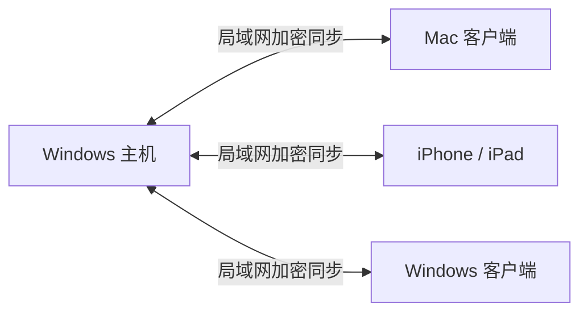

# Private QR Sync

**通过本地局域网进行私密、加密、可选择的 Obsidian 同步——不需要云服务器、账号或订阅。**

简体中文 · [English](README.md)

[](https://github.com/Xr-7777/private-qr-sync/releases/latest)
[](LICENSE)


Private QR Sync 可以让 **Windows、macOS、iPhone 和 iPad** 上的 Obsidian 库在同一可信局域网中直接传输和同步。通过短期二维码完成配对，然后为每台设备分别选择笔记范围、同步方向和权限。

笔记不会经过作者的服务器。配对完成后，请求和文件内容使用 **AES-256-GCM** 在设备间加密传输。GitHub 仅托管公开源代码和发布文件，不会收到你的库数据。

> **已进入官方目录：** 请从 Obsidian 第三方插件市场安装。插件仍处于公开测试阶段，建议先备份原库或使用测试库。

## 为什么选择 Private QR Sync？

- **不经过第三方同步服务器**：使用你自己的电脑作为局域网主机。
- **选择性同步**：可以只同步一篇笔记、几个文件夹或整个库。
- **传输与同步分开**：只复制一次，不必让后续修改持续关联。
- **每台设备独立控制**：可以分别暂停，并设置双向、主机到设备或设备到主机。
- **保留恢复副本**：目标内容被覆盖或删除前会先备份。
- **手机配对简单**：iPhone/iPad 可以直接使用系统相机扫描二维码。
- **安全默认值**：删除同步默认关闭，`.obsidian` 默认排除，密钥存放在 Obsidian SecretStorage。
- **中英文界面**：可以随时切换中文和 English。

## 功能概览

| 项目 | 行为 |
| --- | --- |
| 网络方式 | 在可信私有局域网中，客户端直接连接自己的主机电脑 |
| 支持平台 | Windows/macOS 主机；Windows、macOS、iPhone、iPad 客户端 |
| 传输加密 | 配对后，请求与文件内容使用 AES-256-GCM |
| 配对方式 | 十分钟有效、只能使用一次的二维码或配对链接 |
| 同步范围 | 指定笔记、选择文件夹或整个库 |
| 同步方向 | 双向、主机 → 设备、设备 → 主机 |
| 一次性传输 | 不删除；同名不同内容会另存为第二个文件 |
| 删除同步 | 默认关闭；可按方向开启，删除前创建恢复备份 |
| 云服务/账号 | 不需要 |
| 价格/许可证 | 免费开源，MIT License |

## 工作原理



一台电脑保持 Obsidian 打开并作为主机。每个客户端都有独立、可撤销的密钥和策略。客户端比较 SHA-256 文件清单，只传输发生变化的文件。主机不会把你的 Obsidian 库上传到 GitHub 或第三方中继服务器。

## 快速安装

1. 在所有设备上创建或打开**名称完全相同**的 Obsidian 库。
2. 打开 Obsidian → 设置 → 第三方插件 → 浏览，搜索 **Private QR Sync**，然后选择**安装**并**启用**。
3. 在所有需要参与传输或同步的设备上重复安装。
4. 在作为主机的电脑上打开插件设置，选择**显示二维码**。
5. iPhone/iPad 使用系统相机扫描并在 Obsidian 中打开；其他电脑复制配对链接，粘贴到**将这台电脑作为客户端**。
6. 回到主机，为该设备设置同步方向、选择路径、删除策略和传输权限。

Windows 防火墙提示时，只允许 Obsidian 访问**专用网络**。同步期间需要保持主机唤醒并打开 Obsidian。

## 一次性传输和持续同步

### 一次性传输

适合只复制几篇笔记，不希望后续修改持续关联的场景。

- 在客户端填写准确的笔记路径，或以 `/` 结尾的文件夹路径。
- 选择**主机 → 当前设备**或**当前设备 → 主机**。
- 目标端独有的笔记不会受影响。
- 同名但内容不同的文件会保存为可见的第二个文件。
- 不会执行删除。

### 持续同步

适合让指定笔记持续跟随修改的场景。

- 在主机端为每台设备独立设置。
- 同步路径留空表示整个库。
- 单向同步只会将所选范围内的同路径文件视为由来源端决定。
- 目标端独有的笔记和未选择的内容不会消失。
- 覆盖目标文件前，旧内容会复制到 `.private-qr-sync-conflicts/`。

除非确实希望传播删除，否则请保持**同步删除操作**关闭。开启后，只传播所选路径中之后发生的删除，并且会先创建恢复备份。

## 隐私与安全边界

- 笔记、附件、账号标识和遥测不会发送给作者运营的任何服务。
- 每台配对设备使用独立密钥，并通过 Obsidian SecretStorage 保存。
- 加密响应绑定请求随机数和接口路径，用于拒绝重放或调换响应。
- 局域网观察者仍可能看到 IP 地址、连接时间、消息大小和接口路径。
- 局域网接口使用 HTTP，但应用数据已加密；**不要把端口暴露到公网**。
- 未过期的配对二维码属于临时凭据，请勿拍照或分享。
- 在主机撤销设备后，该设备密钥会失效。

## 当前限制

- 所有设备必须位于能够互相访问的同一私有网络，不提供公网中继。
- 主机电脑需要保持唤醒并打开 Obsidian。
- iOS 会暂停后台第三方插件，传输或同步时请保持 Obsidian 打开。
- `.obsidian` 中的插件和设置不会同步，需要在每台设备分别安装本插件。
- 默认跳过超过 20 MB 的文件，可以在设置中修改限制。
- Android 尚未完成验证，目前不作为正式支持平台宣传。

## 下载、反馈与开发

- [下载最新版本](https://github.com/Xr-7777/private-qr-sync/releases/latest)
- [报告问题或提出建议](https://github.com/Xr-7777/private-qr-sync/issues)

```bash
npm install
npm run check
```

桌面端手动安装时，将 `main.js`、`manifest.json` 和 `styles.css` 复制到：

```text
<vault>/.obsidian/plugins/private-qr-sync/
```

## 支持这个项目

如果 Private QR Sync 确实解决了你的问题，欢迎为仓库点一个 **Star**、分享给其他 Obsidian 用户，并反馈你的设备组合和测试结果。公开测试阶段尤其需要 Windows、macOS、iPhone 和 iPad 的真实使用反馈。

## 许可证

[MIT](LICENSE)——这是独立社区软件，并非 Obsidian 官方产品。
